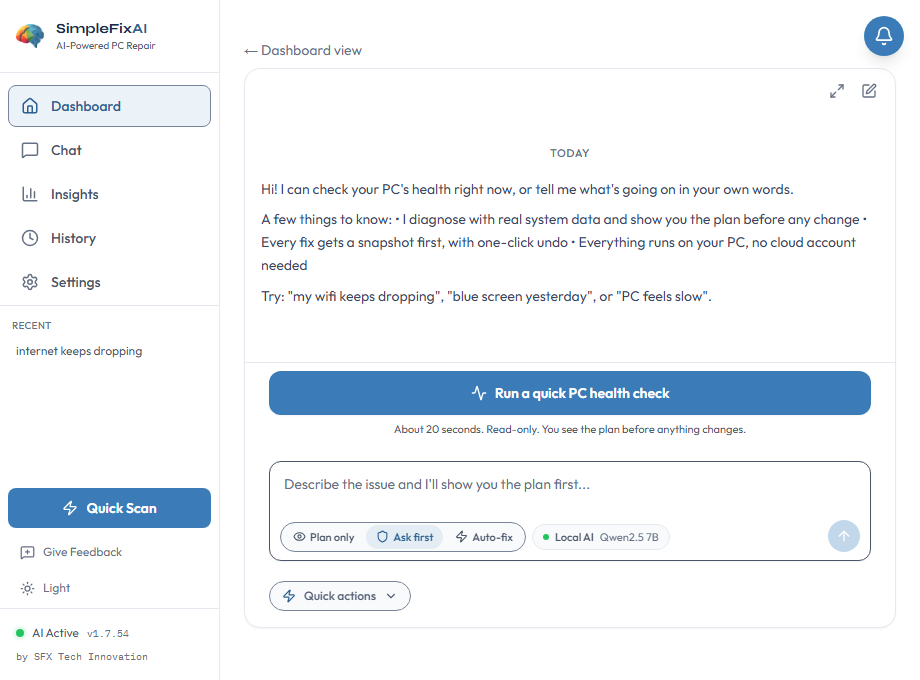
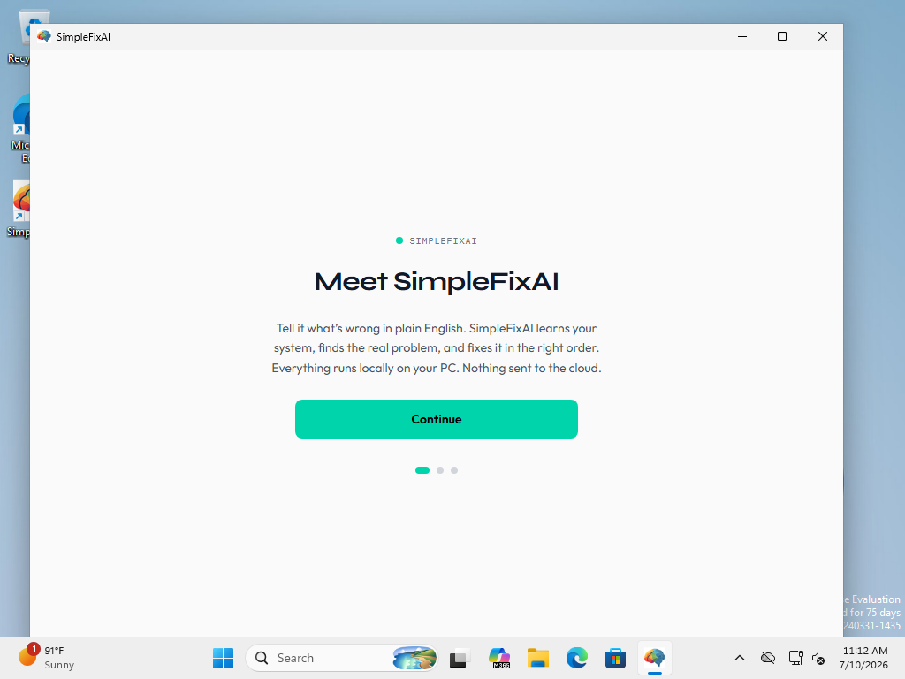
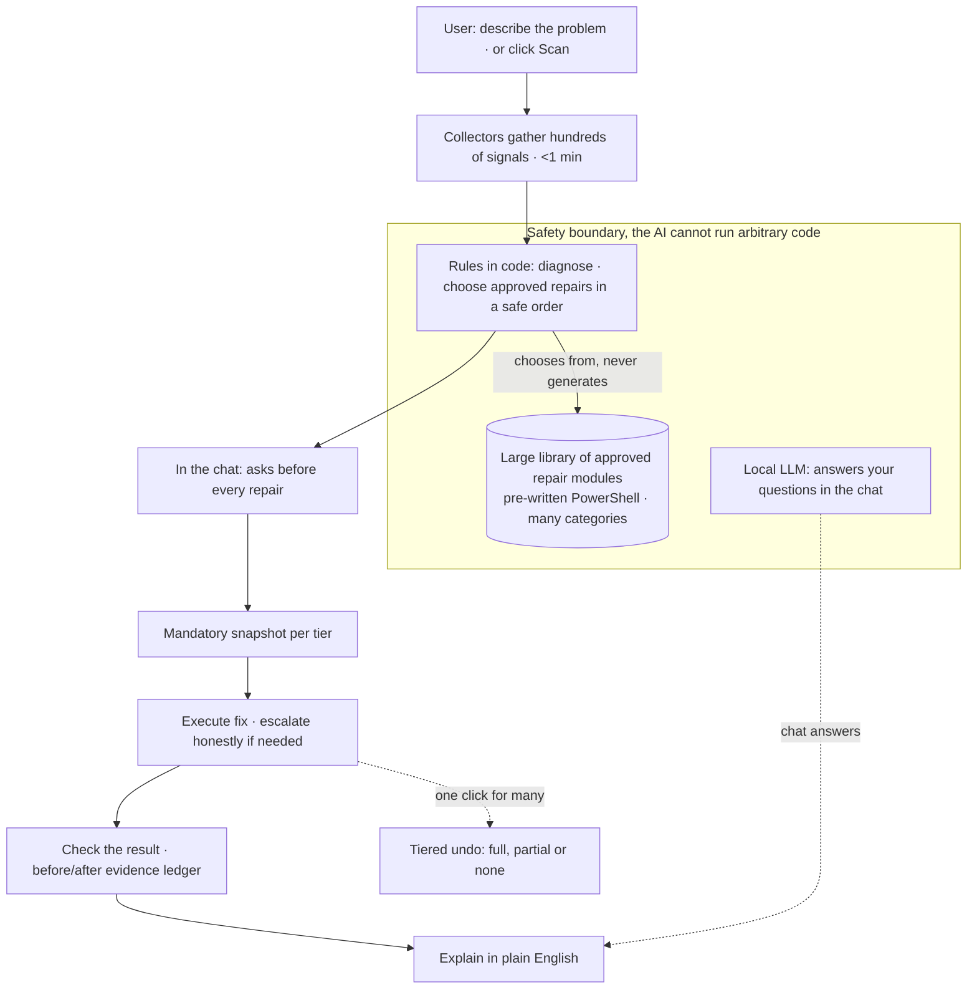

# SimpleFixAI™

> Windows PC repair you can talk to: it reads your system, finds the likely cause, fixes what it safely can in the right order, and explains every step in plain English. In the chat it asks before every repair, every repair gets a safety snapshot first, and it tells you how much undo can put back. Diagnosis, undo and most repairs work offline.

**Live:** [simplefixai.com](https://simplefixai.com)  ·  **Source is private by design**: this repo is a public showcase of the product and its architecture.

<picture>
  <source media="(prefers-color-scheme: dark)" srcset="assets/hero-dark.png">
  
</picture>

## Demo
<video src="https://github.com/SFX-TECH/simplefixai-showcase/raw/main/assets/demo.mp4" poster="https://github.com/SFX-TECH/simplefixai-showcase/raw/main/assets/demo-poster.jpg" controls muted loop width="720"></video>

*The demo shows an earlier version of the app. Player not loading on your device? [Watch the demo](https://github.com/SFX-TECH/simplefixai-showcase/blob/main/assets/demo.mp4).*

---

## See it live

*The product is live at [simplefixai.com](https://simplefixai.com), free while in public beta. This capture is from September 2026; the live site carries the current wording.*

## The problem
There are ~1.4 billion Windows PCs in use. When one breaks, people either paste terminal commands they don't understand or install legacy "cleaner" utilities that run static, decade-old scripts: they can't reason about the actual problem, can't explain what they're doing, and can't undo it when they make things worse. The whole category trades on hope.

## What it does
Windows already ships with the tools to repair itself. SimpleFixAI is the reasoning layer that was missing.

> **In plain terms:** SimpleFixAI reads your PC and works out what is wrong with rules written in code, and an optional local AI model on your own computer answers your questions in plain English. Before it changes anything it saves a safety snapshot, and many repairs can be put back with one click.

*An earlier version's welcome screen, on a clean Windows VM. Today diagnosis, undo and most repairs run on your PC without an internet connection; some repairs need it, and usage and error reports are on by default, with one switch to turn them off.*

1. **Describe it or scan it**: type "my wifi isn't working," or hit Scan.
2. **Diagnose**: collectors gather hundreds of system signals in well under a minute.
3. **Plan the fix**: rules in code choose approved repairs from what the scan found and put them in a safe, dependency-aware order, and the app explains the plan in plain English.
4. **Ask, snapshot, then fix**: in the chat it asks before every repair, and a safety snapshot is always taken before anything changes; for deeper repairs Windows is asked for a restore point too.
5. **Verify + explain**: it checks whether the fix held (confirmed, not yet verified, or did not hold) and tells you, in plain English, what it did.
6. **Undo**: many repairs undo with one click, some only partly, and some leave nothing to undo; it tells you which before you approve.

A **multi-tier repair engine** tries the safest fix first and escalates only if symptoms persist, each tier with its own snapshot. A background **watchdog** watches for problems and reports them to you; unattended repair is off by default, needs your opt-in, and never runs a repair silently.

## Honest by design
SimpleFixAI reports **partial results** honestly instead of faking success, and when a problem is genuinely beyond what it can safely fix (for example, a Windows framework-binary corruption whose real remedy is an in-place upgrade), **it tells you and routes you to the correct fix** rather than running tiers that can't reach it. It makes **no cure-rate claim it cannot measure**. Repair fixers are being checked on a **disposable Windows VM against seeded breakage**, with a **before/after evidence ledger** recording exactly what changed, and no cure is claimed without that proof. For a tool that touches people's machines, trustworthiness is the product.

## The idea that makes it safe (and patent-pending)

> **In plain terms:** The AI is not allowed to type its own commands. Repairs come only from a set of pre-approved, tested fixes that rules in code choose, so a bad instruction or a model mistake cannot make it run anything else on your computer.

The AI **never writes or runs raw commands.** Repairs come only from an **extensive library of pre-written, safety-bounded repair modules**: rules in code choose the approved repairs and their order from what the scan finds, and each step is explained before it runs. The local model writes the chat answers. The design also gives it a **grammar-constrained JSON** seam, checked locally against the catalog, so any model choice could only ever be a valid pick from the catalog, never free-form text that could be misread as a command; that seam is not used to choose repairs today. Code, not the model, decides *what* runs and *how*. A prompt-injection attempt or a model mistake therefore **cannot** make it run anything outside the catalog. This AI diagnostic-orchestration method is covered by a **provisional patent**.

## How it's built

> **In plain terms:** The diagram shows the steps from your request to a checked fix. Rules in code choose the repairs; the AI stays inside a safety boundary, where it can explain but cannot run code of its own.

## Tech

> **In plain terms:** This is the list of building blocks the app is made from. The AI model runs on your machine. Diagnosis, undo and most repairs work with no internet connection; some repairs need it, such as the deeper system file repair, which gets its files from Windows Update.

| Layer | Stack |
|---|---|
| Desktop shell | Tauri 2 (Rust core) + React 19 + Vite (about 48 MB installer) |
| Diagnostic engine | Python 3.11 (WMI, subprocess), shipped as a PyInstaller sidecar, no Python required for users |
| Fix scripts | PowerShell 5.1 (ships with every Windows, zero deps) |
| AI | Optional local GGUF model via llama.cpp, RAM-auto-selected tiers, runs on the PC and writes the chat answers |
| State | SQLite WAL (snapshots, reports, watchdog) |
| Cloud | Cloudflare Workers + R2 (usage report intake, downloads and updates), Supabase (usage tables, sign-up records and feedback), PostHog (product analytics), Sentry (UI error reports) and Hugging Face (model downloads); usage and error reports are on by default and one switch turns them off; none of it is required to repair |
| CI/CD | GitHub Actions → Tauri build · Ed25519-signed auto-updater · per-release SHA-256 checksums (the installer is not code-signed yet) |

## By the numbers
- An **extensive library** of repair modules across many categories, with **behavioral checks on a disposable Windows VM** under way and a **before/after evidence ledger**
- **More than 20,000** automated tests passing in the nightly run, plus a dedicated AI conversation eval harness and a UI test suite
- multi-tier repair engine with honest, snapshot-per-tier escalation
- background watchdog that reports problems; unattended repair is opt-in and never silent
- **RAM-auto-selected** local AI model tiers · runs on your PC · diagnosis, undo and most repairs work offline
- **about 48 MB** installer · per-user install, no admin needed to install
- snapshot before every fix · tiered undo, one click for many repairs
- tamper-evident releases: **Ed25519-signed auto-updater** · **per-release SHA-256 checksums**

## Status
**Shipping.** Live at **[simplefixai.com](https://simplefixai.com)**. Built: multi-tier diagnostic + repair engine, rule-based diagnosis with a local AI for the chat, natural-language chat, snapshot and tiered undo, background watchdog, reporting (incl. PDF), technician mode, installer-integrity verification, telemetry + conversion-funnel pipeline, and a release pipeline with a signed auto-updater.

---

Built by **Jesse Jolly** · [SFX Tech Innovation](https://sfxtechinnovation.com) · [LinkedIn](https://linkedin.com/in/jessegjolly)

*Source code is private and proprietary. This repository showcases the product and its architecture only.*
*SimpleFixAI™ is a trademark of SFX Tech Innovation LLC.*
